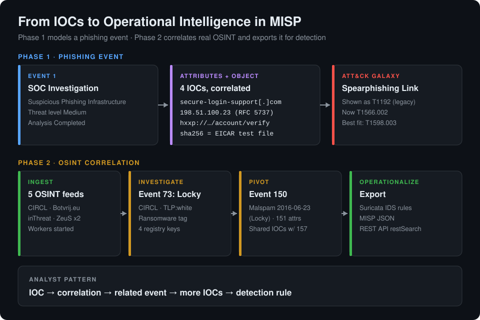
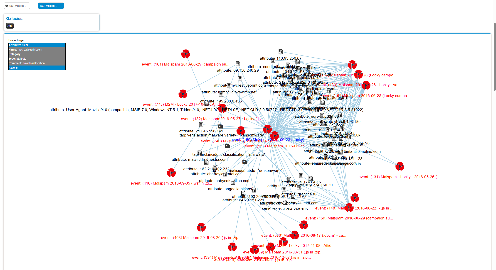
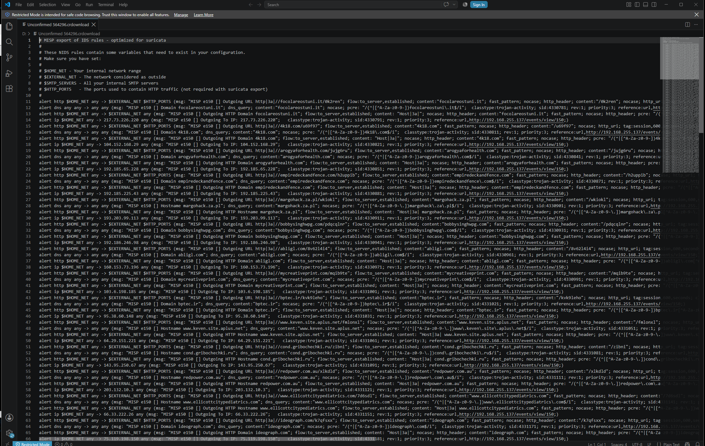
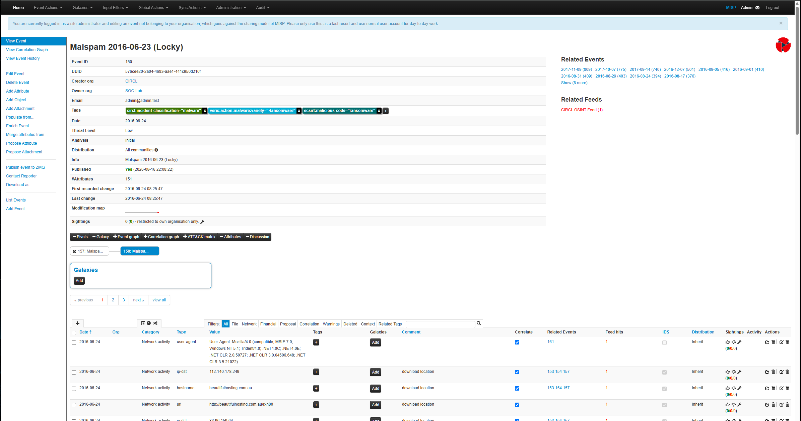
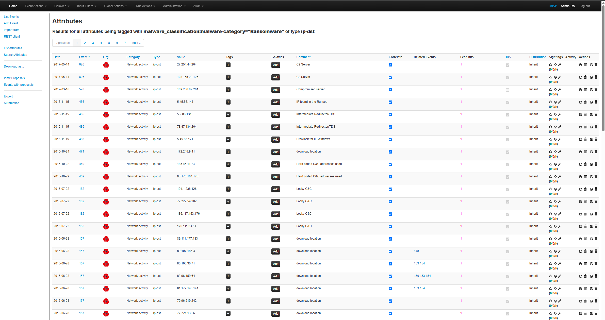
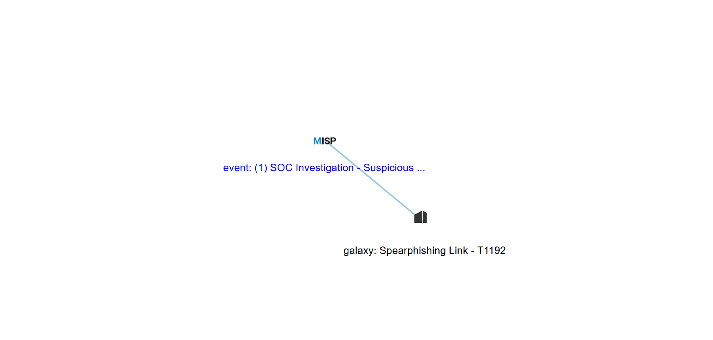
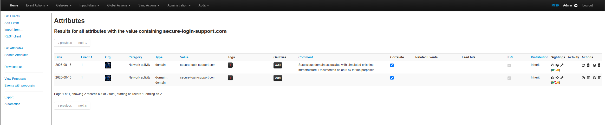
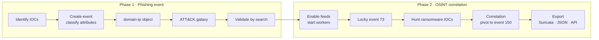

# MISP Phishing Threat Intelligence Lab


A hands-on **cyber threat intelligence (CTI) lab** in **MISP**, the open-source Malware Information Sharing Platform. In the first phase I modeled a phishing investigation: four classified IOCs, a `domain-ip` object, correlation and a MITRE ATT&CK galaxy link, each validated by search. In the second phase I connected MISP to five OSINT feeds, investigated real **Locky ransomware** intelligence, followed shared indicators into a related malspam campaign, and turned the result into **Suricata IDS rules**, MISP JSON and REST API queries. A third phase operationalizes the phishing event with a tested **Python MISP lookup script**, **Sigma rules**, **Splunk hunts** and **custom Suricata rules**.

> **What it shows:** how a SOC or CTI analyst turns isolated indicators into structured, correlated intelligence that detection tools can use. One shared IOC took the investigation from a 6-attribute Locky report (event 73) to a 151-attribute malspam campaign (event 150) linked to more than a dozen other Locky events.



## Why I Did This

An IOC list on its own goes stale fast and answers very little. The value of threat intelligence is in the structure around each indicator: what kind of thing it is, what it relates to, what behaviour it represents and which other activity it connects to. I wanted to build that structure myself in MISP, then work with real community intelligence to see how correlation exposes a campaign, and finish by pushing the intelligence into a format a network sensor can act on.

## Highlights

- **MISP platform setup:** base URL, `SOC-Lab` host organisation, a second organisation and user, five OSINT feeds and background workers configured on MISP 2.4.102.
- **Structured phishing event:** event `1` with domain, `ip-dst`, URL and `sha256` attributes, each with category, comment and correlation enabled.
- **Object modeling:** a `domain-ip` object linking the phishing domain to its destination IP.
- **ATT&CK mapping with version awareness:** galaxy link to Spearphishing Link, shown in the lab as legacy `T1192`, documented with its successor `T1566.002` and the better-fitting `T1598.003`.
- **Search-based validation:** every IOC searched independently; record counts explained (standalone attribute plus object attribute).
- **Safe, verifiable indicators:** IP from the RFC 5737 documentation range, defanged fictional domain, and the SHA-256 of the harmless EICAR test file.
- **OSINT ingestion:** CIRCL OSINT, Botvrij.eu, inThreat and two ZeuS blocklist feeds populated MISP with real historical intelligence.
- **Ransomware threat hunting:** attribute searches across all events for Locky and for ransomware-tagged domains, IPs and SHA-256 hashes.
- **Correlation and pivoting:** shared indicators linked event 157 to event 150, *Malspam 2016-06-23 (Locky)*, and the correlation graph exposed the wider campaign.
- **Operationalization:** Suricata rules and MISP JSON exported from the correlated event; REST API `restSearch` reviewed for automation.
- **MISP lookup script:** a dependency-free Python tool that re-fangs IOCs, queries `restSearch` and groups matches by event and tag, tested against a mock MISP API.
- **Detection content:** three Sigma rules, four Splunk hunts and five Suricata rules built from the phishing event's indicators.

## Screenshots

| Locky campaign correlation graph | Suricata rules generated from MISP |
|---|---|
|  |  |

| Pivot into correlated Locky malspam event | Ransomware-tagged IP hunt across all events |
|---|---|
|  |  |

| Phishing event linked to Spearphishing Link | Domain IOC validated (attribute + object) |
|---|---|
|  |  |

All 28 screenshots are embedded and explained in the [project documentation](#project-documentation).

## Phase 1: Phishing Investigation

### Indicators

| Type | Indicator | MISP category / type | Validation |
|---|---|---|---|
| Domain | `secure-login-support[.]com` | Network activity / `domain` | 2 records ✅ |
| Destination IP | `198.51.100.23` | Network activity / `ip-dst` | 2 records ✅ |
| URL | `hxxp://secure-login-support[.]com/account/verify` | Network activity / `url` | 1 record ✅ |
| File hash | `275a021bbfb6489e54d471899f7db9d1663fc695ec2fe2a2c4538aabf651fd0f` | Payload delivery / `sha256` | 1 record ✅ |

The domain and IP return two records each because they exist both as standalone attributes and inside the `domain-ip` object. The hash is the **EICAR test file**, so it is safe to share and recognisable to any antivirus or intelligence platform.

### Event

```text
Event:        SOC Investigation - Suspicious Phishing Infrastructure
Threat level: Medium
Analysis:     Completed
Galaxy:       Enterprise Attack - Attack Pattern: Spearphishing Link - T1192
```

### MITRE ATT&CK Mapping

| As shown in MISP | Current ATT&CK | Why |
|---|---|---|
| `T1192` Spearphishing Link | `T1566.002` Phishing: Spearphishing Link | Direct successor; `T1192` was revoked in ATT&CK v7 |
| | `T1598.003` Phishing for Information: Spearphishing Link | Best fit for a credential-harvesting `/account/verify` page |

The lab's MISP galaxy predates the change, so the screenshot is kept as it was produced and the current IDs are documented alongside it.

## Phase 2: OSINT Correlation and Operationalization

| Step | Result |
|---|---|
| Ingest | Five OSINT feeds enabled and fetched; the event list filled with APT, malware and ransomware reports |
| Investigate | Event `73`, *OSINT - Locky: the encryptor taking the world by storm* (CIRCL, TLP:white, ransomware tag), with an external report and four Locky registry keys |
| Search | `%Locky%` attribute search across all events, then ransomware-tagged `domain`, `ip-dst` and `sha256` hunts |
| Correlate | Shared download-location domains and IPs linked event `157` to several other events |
| Pivot | Followed to event `150`, *Malspam 2016-06-23 (Locky)*, with 151 attributes and correlations to more than a dozen Locky malspam events |
| Export | Event `150` exported as Suricata rules (HTTP, DNS and IP alerts) and as MISP JSON |
| Automate | REST API `attributes/restSearch` and `events/restSearch` reviewed for SIEM and SOAR integration |

## Phase 3: Operationalizing the Intelligence

| Artifact | What it does |
|---|---|
| [`scripts/misp_ioc_lookup.py`](scripts/misp_ioc_lookup.py) | Looks up IOCs from a CSV or the command line in MISP and reports which events know them |
| [`detections/sigma/`](detections/sigma/) | DNS, proxy and process-hash rules, convertible to any SIEM with `sigma-cli` |
| [`detections/splunk_ioc_hunt.spl`](detections/splunk_ioc_hunt.spl) | DNS, web, Sysmon and lookup-based hunts with first/last seen |
| [`detections/suricata_lab_iocs.rules`](detections/suricata_lab_iocs.rules) | DNS, HTTP, TLS SNI and IP detections (SIDs 9000001–9000005) |
| [`data/iocs.csv`](data/iocs.csv) | The event's indicators, defanged, as a reusable input |

Sample output from testing against a mock of MISP's `restSearch` API:

```text
$ python3 scripts/misp_ioc_lookup.py --ioc 5.45.86.171
[+] 5.45.86.171  ->  MATCH in 1 event(s)
      event 486: OSINT - Locky  [ip-dst]  (malware_classification:malware-category="Ransomware", tlp:white)
```

Because the attachment hash is the EICAR test file, the hash rule can be tested end to end on a lab endpoint without any real malware. See [Operationalizing the Intelligence](docs/08-operationalizing-intelligence.md).

## Tools & Technologies

- **MISP 2.4.102:** events, attributes, objects, galaxies, correlation, feeds, graph views and exports.
- **MISP OSINT feeds:** CIRCL OSINT, Botvrij.eu, inThreat, ZeuS IP and compromised-URL blocklists.
- **MITRE ATT&CK:** technique mapping via the MISP Enterprise Attack galaxy.
- **Suricata:** IDS rule format generated by MISP.
- **MISP REST API:** `restSearch` for automated retrieval.
- **CakePHP console:** MISP administration and worker management.
- **Python 3:** standard-library MISP REST client (`scripts/misp_ioc_lookup.py`).
- **Sigma and Splunk SPL:** SIEM detections and hunts built from the event.

## Investigation Flow



## How This Fits a SOC

```text
SIEM / EDR / email alert → extract IOC → search MISP
    ├─ no match → enrich externally, add to MISP
    └─ match    → review event → related IOCs → hunt telemetry → scope incident → block or detect
```

Threat intelligence is most useful when it enriches an alert and widens the hunt, not when it sits in a list.

## Key Findings

1. **Classification makes intelligence searchable.** Correct categories and types let every IOC be found and correlated.
2. **Objects preserve relationships.** The `domain-ip` object keeps the link between the phishing domain and its host.
3. **ATT&CK IDs change.** The galaxy shows `T1192`; current ATT&CK uses `T1566.002`, and `T1598.003` fits credential harvesting best.
4. **Correlation exposes campaigns.** A single shared indicator connected a small Locky report to a large malspam event and a wider set of related campaigns.
5. **Intelligence must be operational.** Exporting Suricata rules and JSON moves the work from analysis to detection.

## Repository Structure

```text
misp-phishing-threat-intelligence-lab/
├── README.md
├── LICENSE
├── assets/
│   └── diagrams/
│       └── misp-intelligence-workflow.svg
├── data/
│   └── iocs.csv                 # event 1 indicators (defanged)
├── detections/
│   ├── sigma/                   # 3 Sigma rules
│   ├── splunk_ioc_hunt.spl      # 4 Splunk hunts
│   └── suricata_lab_iocs.rules  # 5 Suricata rules
├── scripts/
│   └── misp_ioc_lookup.py       # MISP REST API lookup tool
├── docs/
│   ├── 01-investigation-overview.md
│   ├── 02-ioc-analysis.md
│   ├── 03-misp-object-modeling.md
│   ├── 04-mitre-attack-mapping.md
│   ├── 05-ioc-validation.md
│   ├── 06-analyst-conclusion.md
│   ├── 07-misp-threat-correlation.md
│   └── 08-operationalizing-intelligence.md
└── evidence/
    └── screenshots/
        ├── misp-*.png       # phase 1: ATT&CK graph and IOC validation (5)
        └── 01–23-*.png      # phase 2: setup, Locky, hunting, correlation, exports (23)
```

## Project Documentation

| Phase | Document | Focus |
|---|---|---|
| 01 | [Investigation Overview](docs/01-investigation-overview.md) | Scenario, objectives, scope and methodology |
| 02 | [IOC Analysis](docs/02-ioc-analysis.md) | Domain, IP, URL and SHA-256 analysis |
| 03 | [MISP Object Modeling](docs/03-misp-object-modeling.md) | The `domain-ip` object |
| 04 | [MITRE ATT&CK Mapping](docs/04-mitre-attack-mapping.md) | Galaxy link and current technique IDs |
| 05 | [IOC Validation](docs/05-ioc-validation.md) | Search-based validation and pivoting |
| 06 | [Analyst Conclusion](docs/06-analyst-conclusion.md) | Findings, limitations and recommendations |
| 07 | [MISP Threat Correlation](docs/07-misp-threat-correlation.md) | Setup, feeds, Locky, correlation, pivoting, exports and API |
| 08 | [Operationalizing the Intelligence](docs/08-operationalizing-intelligence.md) | Lookup script, Sigma, Splunk and Suricata detections |

## How to Review

1. **See the model:** [IOC Analysis](docs/02-ioc-analysis.md) and [Object Modeling](docs/03-misp-object-modeling.md) show how the phishing event was structured.
2. **Check the ATT&CK reasoning:** [MITRE ATT&CK Mapping](docs/04-mitre-attack-mapping.md) explains the legacy ID and its current equivalents.
3. **Follow the correlation:** [MISP Threat Correlation](docs/07-misp-threat-correlation.md) walks from feed ingestion through the Locky pivot to the Suricata export.
4. **See it used:** [Operationalizing the Intelligence](docs/08-operationalizing-intelligence.md) shows the lookup script and detection rules built from the event.

## Skills Demonstrated

- **Threat intelligence platforms:** MISP administration, feeds, workers and organisations.
- **IOC management:** attribute categories, types, comments, correlation and IDS flags.
- **Intelligence modeling:** MISP objects and galaxies.
- **Threat hunting:** cross-event attribute searches by value, tag and type.
- **Correlation analysis:** following shared indicators across events and reading correlation graphs.
- **MITRE ATT&CK:** mapping with awareness of revoked and successor techniques.
- **Detection engineering:** generating Suricata rules from intelligence.
- **Automation:** MISP JSON, REST API and a Python lookup client with error handling.
- **Detection-as-code:** Sigma, Splunk SPL and Suricata rules derived from intelligence.
- **Safe indicator handling:** documentation-range IPs, defanging and EICAR as a safe hash.

## Roadmap

- Update the MISP galaxies so event 1 shows `T1566.002` directly (steps in [doc 08](docs/08-operationalizing-intelligence.md#5-completing-the-lab-in-misp))
- Publish event 1 and add sightings to show the IOC lifecycle
- Run the lookup script against the lab instance and add its output as evidence
- Load the Suricata rules into a sensor and test them against a PCAP
- Add warninglists to suppress false positives such as common CDN domains

---

## Disclaimer

This repository was created for cybersecurity education, defensive training and portfolio development. Phase 1 indicators are simulated: the IP is from the RFC 5737 documentation range, the domain is fictional and defanged, and the hash is the harmless EICAR test file. Phase 2 uses public historical OSINT feeds. No real organisation, production environment or user was targeted, and authentication keys are redacted from all evidence.

---

## Author

**Anik Nohan**

This lab was built to practise and demonstrate real-world SOC and CTI skills in:

- Cyber threat intelligence analysis in MISP
- IOC classification, modeling, correlation and validation
- OSINT feed ingestion and ransomware threat hunting
- MITRE ATT&CK mapping
- Detection-rule generation and intelligence automation
- Python tooling and detection-as-code

Also see my **[Phishing Email Investigation Portfolio](https://github.com/aniknohan/phishing-email-investigation-soc-portfolio)**, **[Splunk SOC Analyst Detection Lab](https://github.com/aniknohan/splunk-soc-analyst-detection-lab)** and **[Report Writing Using Phishing Tools](https://github.com/aniknohan/report-writing-using-phishing-tools)**.

### Tools Used

`MISP` • `OSINT Feeds` • `MITRE ATT&CK` • `Suricata` • `Sigma` • `Splunk` • `Python` • `MISP REST API` • `GitHub`

## License

Released under the [MIT License](LICENSE).
